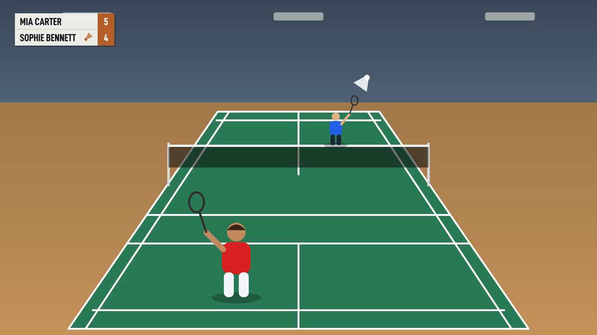
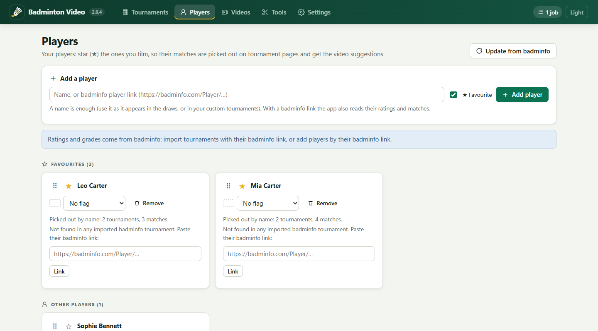
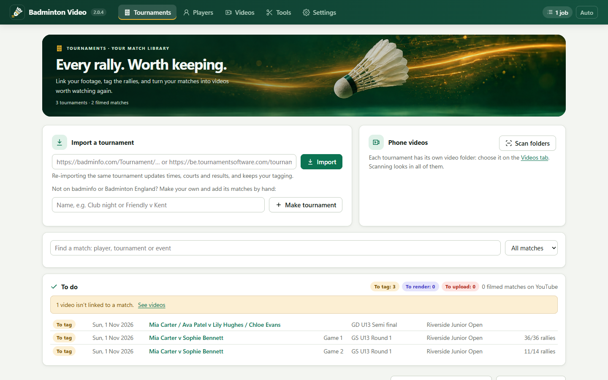
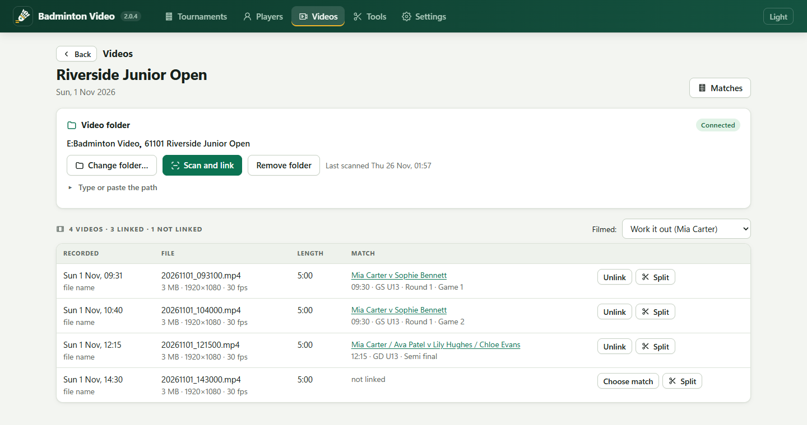
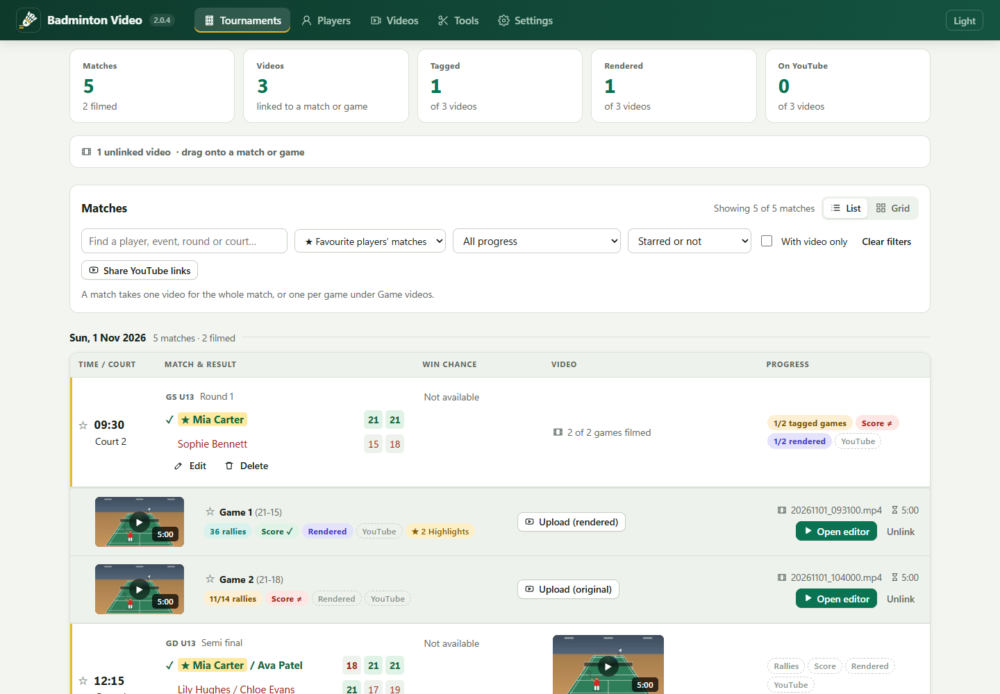
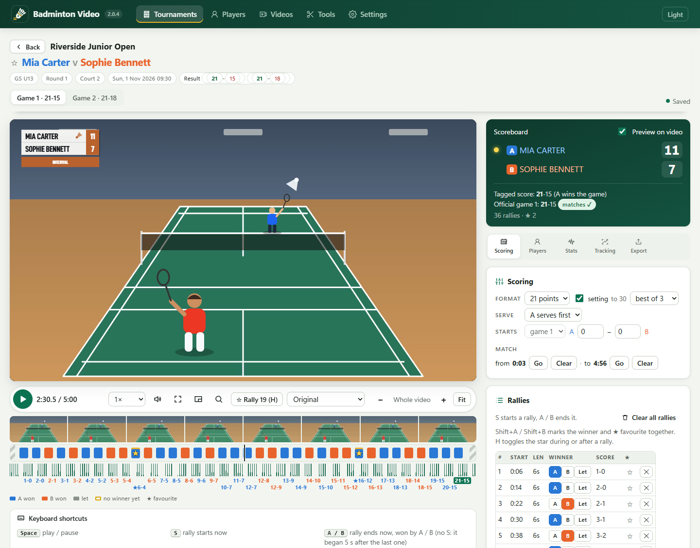
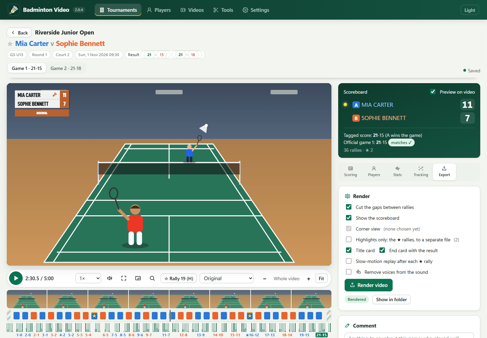
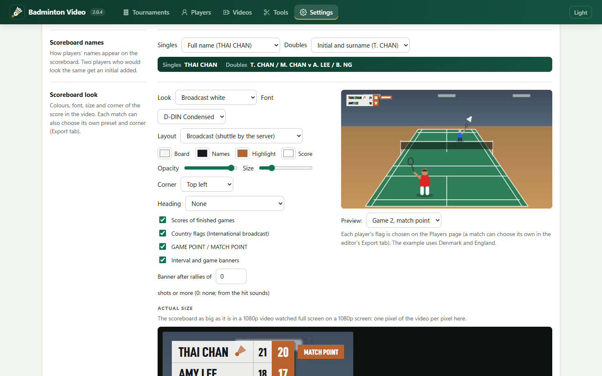

# Badminton Video

A Windows app that turns the phone videos you film at badminton tournaments into finished match videos: a live scoreboard on screen, the waiting between rallies cut out, ready for YouTube.



Everything runs on your own PC. Your original videos are never changed.

*The screenshots use made-up players and a drawn court.*

## Install

1. Run `Badminton-Video-Setup-<version>.exe`. No administrator rights are needed.
2. If Windows says "Windows protected your PC", choose **More info → Run anyway** (the installer isn't signed yet).
3. Open **Badminton Video** from the Start menu.

The app brings its own copy of FFmpeg. An NVIDIA graphics card makes rendering faster, but you don't need one. New versions install themselves: when one is ready the app shows **Restart now**.

## How to use it

### 1. Add your players

Open **Players** and type each player's name, or paste their badminfo player link. Tick **★ Favourite** for the players you film: their matches are picked out everywhere else in the app.



### 2. Import a tournament

On **Tournaments**, paste the tournament's link from **badminfo** or **Badminton England** and click **Import**. Every match comes in with its time, court, players and result.

Not on those sites? Type a name and click **Make tournament**, then add the matches yourself.

The **To do** list shows what's left: videos to tag, to render and to upload.



### 3. Give the tournament its video folder

Put the tournament's videos in one folder (for example `20261101 Riverside Junior Open`). Open the tournament's **Videos** page, click **Choose folder…** and pick it.

The app links each video to its match by when it was recorded. Anything it isn't sure about is left for you: click **Choose match**, or drag the video onto its match on the tournament page.



### 4. Check the tournament page

Each match shows its result, its video (one for the whole match, or one per game) and how far it has got: **tagged**, **score ✓**, **rendered**, **YouTube**. The buttons on each row are the next step. Click **Open editor** to tag a video.



### 5. Tag the rallies

In the editor, first choose **who serves first** on the Scoring tab. Then play the video and use the keyboard:

| Key | What it does |
|---|---|
| **Space** | play / pause |
| **S** | a rally starts now |
| **A** or **B** | the rally ends now, won by side A or side B |
| **L** | a let (replayed, no point) |
| **H** | mark a rally as a ★ highlight |
| **M** / **F** | the match starts / finishes here (anything outside is cut) |
| **←** / **→** | back / on 2 seconds (with Shift: 10 seconds) |
| **[** / **]** | slower / faster |
| **Ctrl+Z** | undo |
| **?** | show every shortcut |

You don't have to press **S**: pressing **A** or **B** alone starts the rally a few seconds after the last one.

The scoreboard follows your tagging, and the panel says whether your score **matches** the official result.



### 6. Render and upload

Open the **Export** tab and click **Render video**. The finished video goes into your output folder (Settings → Finished videos), sorted by year and tournament, with a `.txt` holding its YouTube title and description. The description lists every rally, so viewers can jump to one.

To upload, sign in to YouTube in the **YouTube** box on the same tab. Or use **Upload** on the tournament page, which also adds the video to the tournament's playlist.



### Choose the scoreboard's look

In **Settings** you choose how names appear, the scoreboard's style, colours, size and corner, and what else goes in: finished games' scores, GAME POINT / MATCH POINT, interval banners, a title card and an end card. The preview shows it on one of your videos.



## More it can do

- **Highlights**: render only your ★ rallies, or a **Highlight reel** of the ★ rallies of many matches.
- **Clips**: one rally as a clip, as filmed or upright for Shorts and Reels.
- **Statistics**: the editor's Stats tab shows points won on serve, longest runs, rally lengths and a momentum chart.
- **Corner view and magnifier**: enlarge part of the picture, such as the far court.
- **Share YouTube links**: copy every link of a tournament or player, with results, ready to paste into a message.
- **Merge or split videos** (Tools tab) without losing quality.
- **Correct a wrong result** with **Score ≠** on the tournament page.

### Optional extras

- **Shuttle tracking, player names on the video and voice removal**: set them up with one button in **Settings → Tracking tools**. They need an NVIDIA card and about 6 GB of space.
- **Uploading straight to YouTube** needs your own Google Cloud project: turn on *YouTube Data API v3*, create an OAuth client of type **Desktop app**, and save its JSON as `client.json` in the `data\youtube` folder of the app's data (see below). Then use **Sign in to YouTube** in the editor's YouTube box.

## Where things are kept

- The app's data (database, logs, YouTube sign-in): `%LOCALAPPDATA%\Badminton Video`. Uninstalling leaves it alone.
- Finished videos: the folder in **Settings → Finished videos** (by default `Videos\Badminton`).
- If something fails, the red box's **Details** shows what happened, with a button to open the log.

## For developers

Needs Windows 10 or 11, [Node.js](https://nodejs.org/) 24 and FFmpeg (`winget install Gyan.FFmpeg`). The app uses no npm packages; Electron and electron-builder are only for building the installer (`npm install`).

```
npm start      # run it in a Chrome app window (port 8791, data in data\)
npm run dev    # the same, restarting when files change
npm run app    # the desktop version (Electron)
npm run dist   # build dist\Badminton-Video-Setup-<version>.exe
npm test       # unit tests
```

How it's built:

- `server.js` is a small Node server on 127.0.0.1 with a JSON API in `api/`.
- `lib/` holds the server logic: importing tournaments, matching videos, rendering with FFmpeg, YouTube upload, and the SQLite database (`node:sqlite`, with `migrations/`).
- `public/` is the page: plain HTML, CSS and JavaScript modules. `public/shared/` (scoring rules, scoreboard layout) is used by both the page and the server.

## Licence

MIT: see [LICENSE](LICENSE). The installer includes FFmpeg, which has its own licence (GPL v3, in `resources\ffmpeg` in the install folder). The scoreboard font, D-DIN Condensed (© 2017 Datto Inc.), is under the SIL Open Font License 1.1 and comes with its licence in [public/fonts/OFL-D-DIN.txt](public/fonts/OFL-D-DIN.txt). Shuttle tracking uses [TrackNetV3](https://github.com/qaz812345/TrackNetV3) (MIT), player finding [Ultralytics YOLO11](https://github.com/ultralytics/ultralytics) (AGPL-3.0, downloaded only by the optional set-up) and voice removal [Demucs](https://github.com/facebookresearch/demucs) (MIT).
